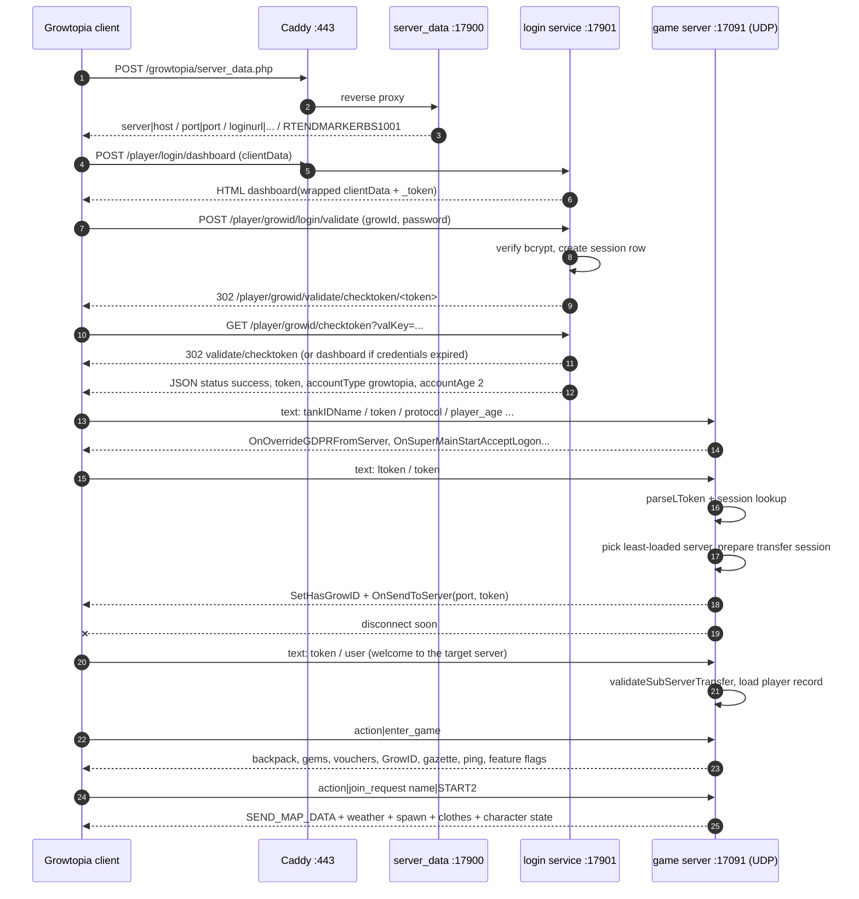

# GrowServer login flow

How a retail Growtopia client goes from "open the game" to standing in a world on this server, with the code that implements each step.

## Components and ports

| Part | File | Port |
|---|---|---|
| Caddy (HTTPS front, `www.growtopia1.com`, `login.growserver.test`, `cdn.growserver.test`) | `src/utils/caddy.ts`, `configs/caddy/Caddyfile.dev` | 443 |
| `server_data.php` + game HTTP | `src/services/https-server.ts` | 17900 |
| Login portal / token service | `src/services/login-server.ts` | 17901 |
| CDN assets | `src/services/cdn-server.ts` | 17902 |
| Game server (ENet, UDP) | `src/game/server/game-server.ts` | 17091 |

`hosts` must point the client domains at `127.0.0.1` (`update-hosts.ps1`, `src/scripts/setup.ts`). The client verifies TLS, so Caddy must serve a trusted certificate for those names.

## Sequence



## 1. `server_data.php`

`src/services/https-server.ts` → `POST /growtopia/server_data.php`.

The body must carry `protocol`, `version` and `platform`, and the user agent must start with `HTTPS.USER_AGENT_PREFIX` (`UbiServices_SDK`), otherwise the request is rejected with **403**. The reply is a text packet terminated by `RTENDMARKERBS1001`:

```
server|<getServerAddress()>
port|<least loaded game server port>
loginurl|<HTTPS.LOGIN_URL>
RTENDMARKERBS1001
```

`getServerAddress()` is always `127.0.0.1` in development; the port comes from `serverManager.getOptimalServer("least_connections")` so the client is spread over every configured `server_ports` entry.

## 2. Dashboard

`src/services/login-server.ts` → `POST /player/login/dashboard` (aliases `/dashboard`).

The client posts its pipe-separated `clientData`. The handler extracts `tankIDName` as a prefill and renders `dashboard.html`; the raw `clientData` is embedded in the page so it survives the HTML round trip and can be replayed into the token endpoints.

## 3. Credential validation

`POST /player/growid/login/validate` (alias `/login`).

1. Credentials are looked up through `AccountDB.getWithPlayer("credential", growId)`; legacy `PlayerDB` passwords are migrated into an `accounts` row on the first login.
2. `Bun.password.verify` compares the bcrypt hash.
3. On success: `SessionDB.create(player.id, { ipAddress, userAgent, ttlDays: 30 })` and `PlayerDB.updateLastSeen`.
4. The response is a **302** to `/player/growid/validate/checktoken/<token>` where the token is `generateLoginToken()`: base64 of URL-encoded `_token=<session>`, `loginData=<pipe data with tankIDName + tankIDPass>`, `type=<login type>` and `username`.

Wrong password / unknown account returns the dashboard again (never the token).

## 4. Token endpoints

| Route | Purpose |
|---|---|
| `POST /player/growid/checktoken` | WebView step. If the posted `refreshToken`/`token` still decodes to valid credentials it creates a fresh session and **302s** to `validate/checktoken`; otherwise it returns the dashboard. |
| `GET /player/growid/validate/checktoken/:token` | Intercepted by the client. Returns the JSON the client stores: |

```json
{
  "status": "success",
  "message": "Account Validated.",
  "token": "<the token>",
  "url": "",
  "accountType": "growtopia",
  "accountAge": 2
}
```

`accountType` must be `growtopia` and `accountAge` is an **age category**, not years — `2` is what the official login returns for a normal adult account; any other value leaves the client in restricted mode ("Chat is disabled.").

## 5. First game connection (logon)

`src/game/server/game-server.ts` → `handlePacket` (text packets only).

The first text packet carries `tankIDName`, `token`, `protocol` and `player_age`:

- `OnOverrideGDPRFromServer(max(18, player_age), 1, 0, 1)` and `OnSuperMainStartAcceptLogonHrdxs47254722215a(...)` are sent (`VariantHandler.sendSuperMain`). The settings string echoes the client's `protocol` and carries `isPayingUser=1`, otherwise the client hangs on the loading screen.
- A second packet with `ltoken` is the real logon: `player.auth.parseLToken(ltoken)` + `player.auth.validate()` + `SessionDB.getByToken(...)`. An invalid or expired session gets `Invalid or expired session token, please login again.` and no world.
- On success the server resolves the database player (`PlayerDB.getByName`), picks the least loaded game server, creates a transfer session (`player.auth.prepareTransfer`) and answers with:

```
SetHasGrowID(true, name, sessionToken)
OnSendToServer(host, targetPort, "", WELCOME, transferToken)
```

then disconnects the peer (`disconnectLater`) so the client reconnects to the target port.

## 6. Sub-server welcome

The client connects to the target port and sends `token|...` + `user|...`:

- `player.auth.parseRaw(payload)` and `player.auth.validateSubServerTransfer(token, user)` reject forged transfers (`Sub-server transfer verification failed or expired.`).
- `player.playerId` comes from `user`, and `PlayerDB.getById(playerId)` fills role, gems, level, inventory (`Player.loadFromRecord`).
- Player state moves to `IN_GAME`.

Why this indirection exists: the entity that accepts the session token is always the "lobby" port from `server_data.php`; actual worlds run on whichever port the load balancer picked, so the lobby hands out a short-lived transfer token instead of sharing state.

## 7. `enter_game`

`src/game/network/game-message-handler.ts` → `EnterGame`.

The client builds its UI when it sends `action|enter_game`, so everything the UI needs is sent here, in this order:

`OnConsoleMessage` welcome → `sendInventory()` → `OnSetBux(gems, true)` (64-bit) → `OnSetVouchers` → `OnOverrideGDPRFromServer` again → `SetHasGrowID(true, tankIDName, ...)` → `OnTodaysDate` → `OnRequestHoustonPricing` → `OnRequestWorldSelectMenu`/gazette → `PING_REQUEST` → `OnSetFeatureEnableFlags`.

Missing any of these leaves a blank backpack, guest mode (no GrowID), disabled chat or no world menu.

## 8. `join_request`

`action|join_request name|WORLD` → `JoinRequest`:

- name validation (`\W|_`, length ≤ 24, not `EXIT`), otherwise `OnFailedToEnterWorld`.
- `player.enterWorld(name)` → `WorldManager.get(name)` (memory → disk `data/worlds/<first char>/<name>.bin` → procedural generation).
- `World.enter(player)` sends `SEND_MAP_DATA` (modern format, `WORLD_DATA_VERSION = 0x19`), the weather, the per-reader lock/sheet resync, `OnSpawn` for every avatar, clothes and character state, then the "world entered" console line.

## Failure checklist

| Symptom | Check |
|---|---|
| `server_data.php` answers 403 | User agent prefix, `protocol`/`version`/`platform` in the body, Caddy route |
| Client stuck on loading | `sendSuperMain` settings (`isPayingUser=1`, protocol echo), GDPR override sent before it |
| "Chat is disabled." | Login JSON: `accountType: "growtopia"`, `accountAge: 2`; GDPR override in the logon and in `enter_game` |
| Guest mode, empty profile | `SetHasGrowID` with the real name + session token |
| `Invalid or expired session token` | `SessionDB` row survives (30 day TTL), token decodes to the same `_token` |
| `Sub-server transfer verification failed` | `OnSendToServer` port reachable, `prepareTransfer`/`validateSubServerTransfer` pair, clock skew |
| Client logs `Wrong world version` | `WORLD_DATA_VERSION` in `src/game/world/constants.ts`; the payload still loads, the layout is the modern one |
| World joins but nothing renders | `SEND_MAP_DATA` extra data length, `items.dat` hash matches what the CDN serves |
